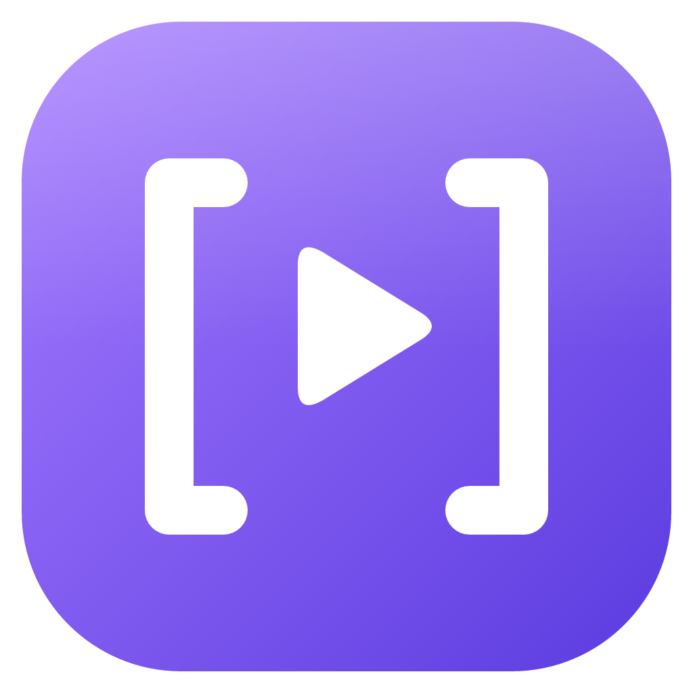
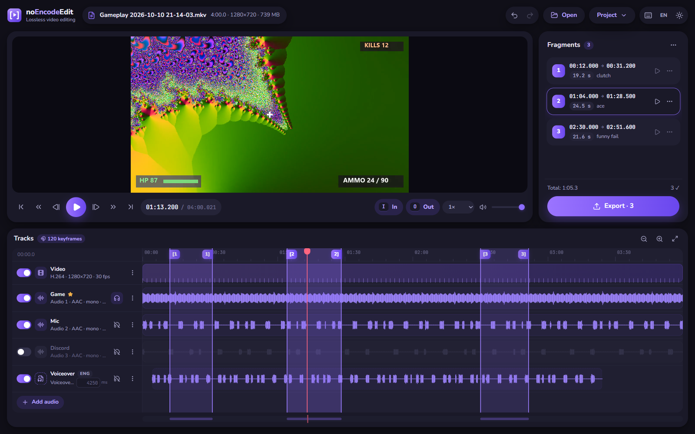
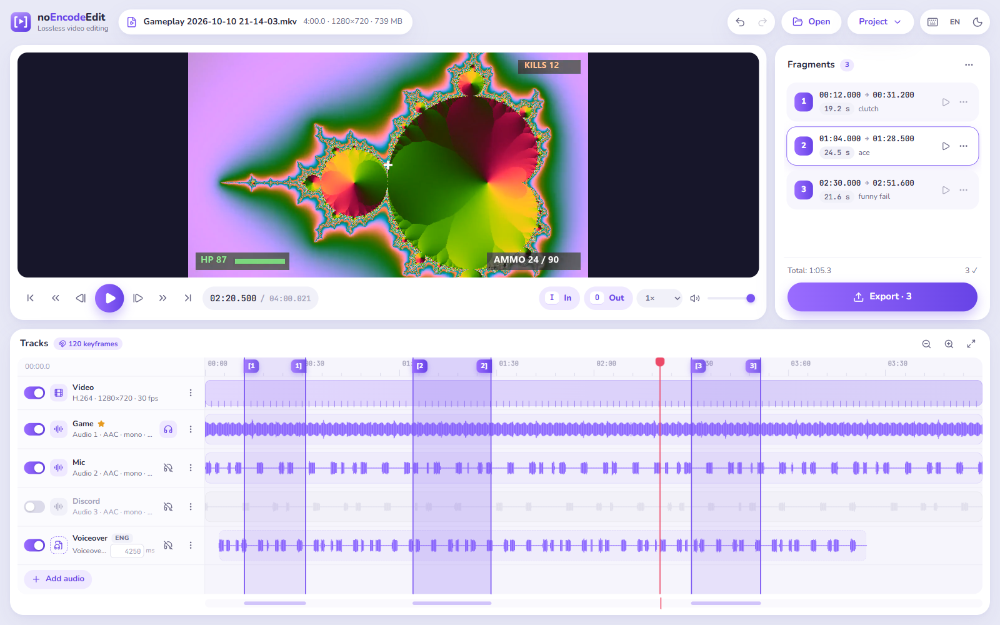
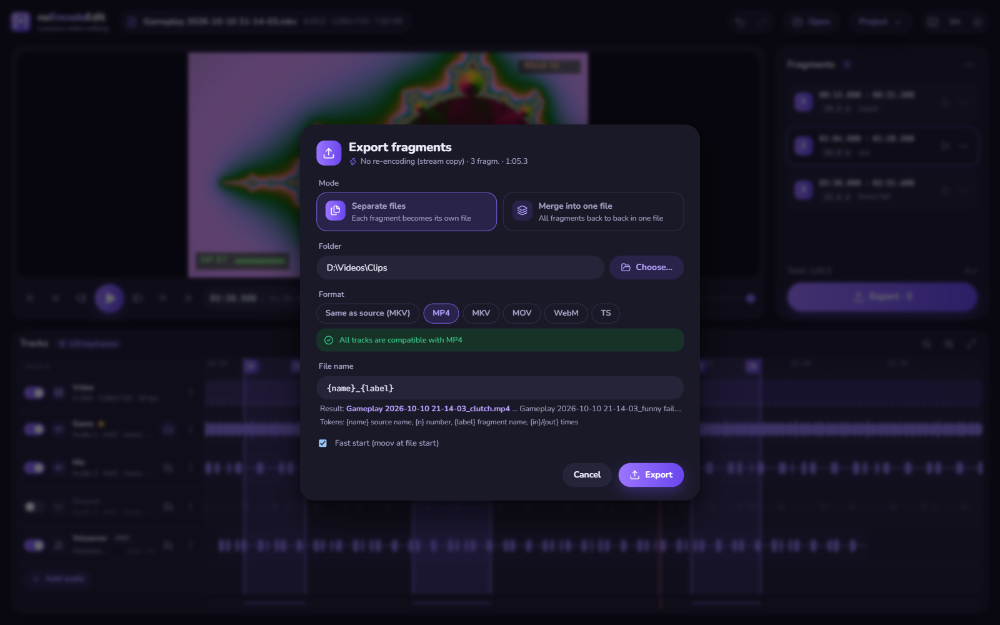

<div align="center">



# noEncodeEdit

**Lightweight, fast, lossless video trimmer and audio-track editor for Windows.**

Cut clips and replace, add or remove audio tracks **without re-encoding** — exports take seconds and keep 100% of the original quality.
Perfect for gameplay recordings, stream VODs, screen captures and any other video you just need to trim.

[](https://github.com/vadmonboss/noEncodeEdit/releases/latest)
[](https://github.com/vadmonboss/noEncodeEdit/releases)

[](LICENSE)



</div>

---

## Why noEncodeEdit?

Most editors re-encode your video on export: it's slow, it heats up your PC and every pass loses quality.
noEncodeEdit uses FFmpeg **stream copy** instead — it only rearranges the existing compressed data. A 10-minute
highlight from a 2-hour 1080p60 recording is saved in a few seconds, bit-for-bit identical to the source.

### Made for gameplay recordings

- **OBS multi-track recordings just work.** Game audio, microphone and Discord on separate tracks? Each one gets
  its own row with a waveform — keep the ones you want, mute the rest, export.
- **Clip highlights in one go.** Mark as many In/Out ranges as you like while you scrub, then export them all at
  once as separate files — or merged into one montage.
- **Fix the audio without touching the video.** Remove a noisy mic track, drop copyrighted music, add a voiceover
  or a fresh soundtrack, and shift it by milliseconds until it lines up.
- **MKV-friendly.** Record in MKV (crash-safe) and export clips straight to MP4 for uploading — still no re-encoding.

## Features

| | |
|---|---|
| ✂️ **Lossless trimming** | FFmpeg stream copy — no re-encoding, no quality loss, exports in seconds |
| 🎯 **Keyframe-aware markers** | Keyframes are drawn on the timeline and the fragment start snaps to them, so what you see is what you get. Hold <kbd>Alt</kbd> for a free placement — the fragment then shows ⚠ with how much earlier the video will actually start |
| 📚 **Multiple fragments** | Mark any number of In/Out pairs, rename, fine-tune, preview or delete them in a list; full undo/redo |
| 📦 **Batch export** | All fragments as separate files into a folder of your choice, with a file-name template (`{name}`, `{n}`, `{label}`, `{in}`, `{out}`) |
| 🔗 **Merge mode** | Join all fragments into a single file, still without re-encoding |
| 🎧 **Audio tracks** | Enable/disable, reorder, set language and title; add external audio as a new track or as a replacement |
| ⏱️ **Audio offset** | Shift external audio in milliseconds or drag it on the timeline |
| ✅ **Compatibility check** | Before export FFmpeg does a dry run with the chosen container. If a track doesn't fit (e.g. AAC in WebM) you're told which one and offered MKV or to disable it |
| 🌊 **Waveforms** | Every audio track shows its waveform, so silences and loud moments are easy to find |
| 🎵 **Audio files too** | Open MP3 / M4A / FLAC / WAV … and trim them the same way |
| 💾 **Projects** | Save your markers, tracks and offsets to a `.nee` file and continue later |
| 🌗 **Light & dark theme** | Plus English and Russian UI |
| 🔒 **Offline & private** | No accounts, no telemetry, nothing leaves your PC |

Supported inputs include MP4, MKV, MOV, WebM, TS/M2TS, AVI, FLV, MP3, M4A, FLAC, WAV, OGG/Opus and more — anything FFmpeg
can read. Formats the built-in player can't show directly (e.g. AVI, AC-3/DTS audio) get a lightweight *preview-only*
copy in a temp folder; the export itself is always a stream copy of the original.

<div align="center">


</div>

## Download

Grab the latest version from **[Releases](https://github.com/vadmonboss/noEncodeEdit/releases/latest)**:

| File | What it is |
|---|---|
| `noEncodeEdit_x.y.z_x64-setup.exe` | Installer (Start menu shortcut, uninstaller, `.nee` project association) |
| `noEncodeEdit_x.y.z_x64_portable.zip` | Portable — unzip anywhere and run `noEncodeEdit.exe`, nothing is installed |

FFmpeg is bundled, so there's nothing else to install. Requires Windows 10/11 x64 with the Microsoft Edge WebView2
runtime (built into Windows 11 and present on up-to-date Windows 10; the installer adds it if missing).

> Windows SmartScreen may warn on first launch because the app isn't code-signed. Click **More info → Run anyway**.

## Quick start

1. **Open** a video (button, <kbd>Ctrl</kbd>+<kbd>O</kbd> or drag & drop onto the window).
2. Scrub to the start of a moment and press <kbd>I</kbd>, then to its end and press <kbd>O</kbd>. Repeat for every clip you want.
3. Toggle the audio tracks you want to keep. Drop an extra audio file onto the window to add or replace a track.
4. Press **Export** (<kbd>Ctrl</kbd>+<kbd>E</kbd>), pick a folder and a format — done.

### Keyboard shortcuts

| Keys | Action |
|---|---|
| <kbd>Space</kbd> | Play / pause |
| <kbd>I</kbd> / <kbd>O</kbd> | Fragment start (snaps to keyframe) / end |
| <kbd>Alt</kbd>+<kbd>I</kbd> | Fragment start, exact (no snapping) |
| <kbd>Shift</kbd>+<kbd>I</kbd> / <kbd>Shift</kbd>+<kbd>O</kbd> | Set selected fragment's start / end to the playhead |
| <kbd>←</kbd> / <kbd>→</kbd> | Previous / next frame |
| <kbd>Shift</kbd>+<kbd>←</kbd> / <kbd>→</kbd> | 1 second back / forward |
| <kbd>Ctrl</kbd>+<kbd>←</kbd> / <kbd>→</kbd> | Previous / next keyframe |
| <kbd>↑</kbd> / <kbd>↓</kbd> | Previous / next mark |
| <kbd>[</kbd> / <kbd>]</kbd> | Go to selected fragment's start / end |
| <kbd>Del</kbd> | Delete selected fragment |
| <kbd>Ctrl</kbd>+<kbd>Z</kbd> / <kbd>Ctrl</kbd>+<kbd>Y</kbd> | Undo / redo |
| <kbd>+</kbd> / <kbd>−</kbd> / <kbd>\\</kbd> | Zoom timeline in / out / fit |
| <kbd>Ctrl</kbd>+<kbd>S</kbd> | Save project |
| <kbd>F1</kbd> | Show all shortcuts |

## How lossless cutting works (and its limits)

Compressed video stores full pictures only at **keyframes**; the frames in between are differences. Without
re-encoding, a clip can only *start* on a keyframe. noEncodeEdit scans the keyframes of the file, draws them on the
timeline and snaps the fragment start to the nearest one, so the result starts exactly where you see it.

If you place a start between keyframes (with <kbd>Alt</kbd>), the exported video begins at the previous keyframe
and the fragment is marked ⚠ with the exact difference. Audio stays in sync either way.

Good to know:

- **Recording tip:** set a fixed keyframe interval in your recorder (OBS → *Output → Keyframe Interval*: 1–2 s) to
  get fine-grained cut points.
- The end of a clip may include one or two extra frames because of B-frame reordering.
- Audio may start a few tens of milliseconds before the first video frame (B-frame decode delay); MPEG-TS sources can
  show up to ~0.25 s.
- Container quirks are handled for you: FFmpeg's seek heuristics for B-frame video in MKV/FLV/AVI are compensated,
  MPEG-TS uses timestamp-based keyframe selection, and missing timestamps in AVI are regenerated.

## Building from source

Requirements: Windows 10/11, [Node.js](https://nodejs.org) 20+, [Rust](https://rustup.rs) (stable, MSVC) and
Visual Studio Build Tools with the C++ workload.

```bash
git clone https://github.com/vadmonboss/noEncodeEdit.git
cd noEncodeEdit
npm install
npm run fetch-ffmpeg   # downloads the pinned FFmpeg build into src-tauri/resources/ffmpeg
npm run app:dev        # run in development mode
npm run release        # build the installer + portable zip into release/
```

Project layout:

- `src/` — UI (React + TypeScript): `controller.ts` (app logic), `engine.ts` (preview playback), `components/`, `i18n.ts`
- `src-tauri/src/ff.rs` — everything FFmpeg/ffprobe: probing, keyframes, waveforms, preview proxies, export, compatibility check
- `src-tauri/src/media_server.rs` — tiny localhost HTTP server with Range support that feeds the built-in player
- `scripts/` — FFmpeg download, icon rendering and release packaging

Built with [Tauri 2](https://tauri.app), [React](https://react.dev) and [FFmpeg](https://ffmpeg.org).

## License

noEncodeEdit is free software released under the **GNU General Public License v3.0 or later** — see [LICENSE](LICENSE).

### Third-party components

- **FFmpeg** — GPL v3. Binaries from [BtbN/FFmpeg-Builds](https://github.com/BtbN/FFmpeg-Builds) (`n9.0.2-25-g67b60c310b`, win64 GPL shared);
  corresponding source: FFmpeg commit [`67b60c310b`](https://github.com/FFmpeg/FFmpeg/commit/67b60c310b) plus the BtbN build scripts.
  The license text ships next to the binaries as `ffmpeg/FFMPEG-LICENSE.txt`.
- **Tauri**, **React**, **Zustand** — MIT / Apache-2.0
- **Lucide** icons — ISC
- **Nunito** and **JetBrains Mono** fonts — SIL Open Font License 1.1
